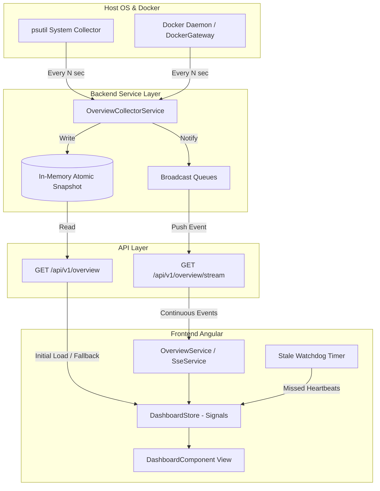

# Design Spec: Master Prompt 02 - Overview Dashboard

**Date:** 2026-11-19  
**Status:** Approved  
**Scope:** Host health metrics, container state aggregations, top CPU/RAM consumers, recent Docker events, SSE streaming, signal-based Angular dashboard store, and responsive visual widgets.

---

## 1. Requirements & User Intent

### 1.1 Goal
Provide a unified, one-glance real-time health dashboard for the host Linux server and all Docker containers.

### 1.2 Functional Scope
- **Host Metrics:** CPU utilization (%), RAM utilization (used/total/percentage), Disk root usage (used/total/percentage), Load average (1m, 5m, 15m), and Server Uptime.
- **Container Counts by State:** Aggregations for `running`, `exited`, `restarting`, `unhealthy`, and `paused`.
- **Top Consumers:** Top 5 containers ranked by CPU consumption and top 5 containers ranked by Memory consumption.
- **Recent Events:** Last 10 Docker lifecycle events with relative timestamps and container links.
- **Active Alerts:** Count of unresolved alerts with alert banner.
- **Real-Time Streaming:** Server-Sent Events (SSE) endpoint pushing updates every 3 seconds (configurable).
- **Stale Data Watchdog:** Frontend detection flagging data stale if updates cease for $> 2\times$ the configured interval.
- **Role Enforcement:** Accessible to `viewer`, `operator`, and `admin` roles.

---

## 2. Architecture & Data Flow



---

## 3. Backend Specification

### 3.1 Configuration (`config/app.yaml`)
```yaml
metrics:
  interval_seconds: 3
  top_containers_limit: 5
  recent_events_limit: 10
  stale_threshold_multiplier: 2.0
```

### 3.2 Data Models & Schemas (`backend/app/schemas/overview.py`)
```python
from pydantic import BaseModel
from typing import List, Optional
from datetime import datetime

class HostMetrics(BaseModel):
    cpu_percent: float
    memory_percent: float
    memory_used_bytes: int
    memory_total_bytes: int
    disk_percent: float
    disk_used_bytes: int
    disk_total_bytes: int
    load_avg: List[float]
    uptime_seconds: int

class ContainerStateCounts(BaseModel):
    total: int
    running: int
    exited: int
    restarting: int
    unhealthy: int
    paused: int

class ContainerConsumerSummary(BaseModel):
    id: str
    name: str
    image: str
    cpu_percent: float
    memory_bytes: int
    memory_percent: float
    status: str

class DockerEventSummary(BaseModel):
    id: str
    action: str
    actor_type: str
    actor_name: str
    timestamp: datetime

class OverviewResponse(BaseModel):
    host: HostMetrics
    containers: ContainerStateCounts
    top_cpu: List[ContainerConsumerSummary]
    top_memory: List[ContainerConsumerSummary]
    recent_events: List[DockerEventSummary]
    active_alerts_count: int
    docker_connected: bool
    timestamp: datetime
```

### 3.3 Collector Service (`backend/app/services/overview_service.py`)
- Background task initialized on FastAPI startup.
- Periodically collects `psutil` metrics and `DockerGateway` stats.
- Caches the current `OverviewResponse`.
- Dispatches new snapshots to active SSE subscriber queues.
- Catches Docker daemon connection issues; sets `docker_connected=False` and zero counts without interrupting host metrics.

### 3.4 REST & SSE Endpoints (`backend/app/api/v1/overview.py`)
- `GET /api/v1/overview`: Returns current snapshot. Requires `viewer` role.
- `GET /api/v1/overview/stream`: Returns `text/event-stream` stream. Yields JSON events and `: ping` heartbeat comments every interval. Cleanly handles client cancellations.

---

## 4. Frontend Specification

### 4.1 Models & Configuration (`frontend/src/app/core/models/overview.model.ts`)
- TypeScript models mirroring backend schemas.
- Color mappings and status constants aligned with design tokens.

### 4.2 Dashboard Store (`frontend/src/app/features/dashboard/dashboard.store.ts`)
- **State Signals:**
  - `data: Signal<OverviewResponse | null>`
  - `isLoading: Signal<boolean>`
  - `isStale: Signal<boolean>`
  - `error: Signal<string | null>`
  - `lastReceivedAt: Signal<number>`
- **Computed Signals:**
  - `hasContainers: Signal<boolean>`
  - `containerStateChartData: Signal<ChartConfiguration<'doughnut'>['data']>`
  - `topCpuChartData: Signal<ChartConfiguration<'bar'>['data']>`
  - `topMemoryChartData: Signal<ChartConfiguration<'bar'>['data']>`
- **Stale Detection:**
  - Runs periodic timer (1s interval).
  - If `Date.now() - lastReceivedAt > interval_seconds * stale_threshold_multiplier * 1000`, marks `isStale(true)`.

### 4.3 Component Layout (`frontend/src/app/features/dashboard/dashboard.component.ts`)
- **Row 0: Notifications & Disconnection Banner:**
  - Stale stream banner when `isStale()` is active ("Live updates paused - reconnecting...").
  - Active alert warning badge if `active_alerts_count > 0`.
- **Row 1: Host Metrics Grid (4 cards):**
  - CPU Gauge Card: CPU %, mini progress bar, 1/5/15m load average.
  - RAM Gauge Card: RAM %, used / total GiB formatted, progress bar.
  - Disk Gauge Card: Root disk %, used / total GiB formatted, progress bar.
  - Uptime Card: Humanized uptime string (e.g. "14d 6h 32m"), boot timestamp.
- **Row 2: Container Overview & Top Consumers:**
  - Left: Donut chart (`ng2-charts` / Chart.js) with center total count, status breakdown, and links to container list.
  - Right: Horizontal bar charts for Top 5 CPU and Top 5 Memory consumers with container navigation links.
- **Row 3: Recent Activity & Empty State:**
  - Recent Docker events feed table/list (action, actor, relative time).
  - Clean empty placeholder if 0 containers exist.

---

## 5. Error Handling & Edge Cases

1. **Docker Daemon Down:** Backend sets `docker_connected: false`; UI surfaces warning banner while keeping host CPU/RAM metrics visible.
2. **SSE Disconnection:** Frontend auto-reconnects with exponential backoff (1s, 2s, 4s... max 30s) while stale banner informs user.
3. **Zero Containers:** Empty state card rendered in place of donut/top consumers; no divide-by-zero or undefined errors.
4. **Permissions:** Route protected by `authGuard`; unauthenticated requests redirect to `/login`.

---

## 6. Testing Plan

### 6.1 Backend (`pytest`)
- `test_overview_collector_psutil_and_gateway`: Unit tests with `FakeDockerGateway` verifying calculation, sorting, and edge cases.
- `test_overview_api`: REST endpoint verification, authentication check, response shape.
- `test_overview_stream_sse`: SSE streaming verification, message parsing, keepalive comment.
- `test_overview_docker_offline`: Verifies behavior when Docker client raises exceptions.

### 6.2 Frontend (`Jest`)
- `dashboard.store.spec.ts`: Test initial load, SSE updates, computed chart data, and stale timer activation.
- `dashboard.component.spec.ts`: Component rendering with populated metrics, empty states, error states, and stale banner.
- `overview.service.spec.ts`: HTTP request and SSE subscription handling.
